# GitOps and Kubernetes Application Deployment Using Argo CD

**Module:** DSO202 — Scaling, Orchestration, Monitoring & Observability  
**Programme:** BE in Software Engineering  
**Practical:** 04 of 10  
**Student Name:** Tshering Phuntsho  
**Student Number:** 02230310   
**Date:** 03 November, 2026

## 1. Introduction

GitOps is a modern approach to managing and deploying applications on Kubernetes by using Git repositories as the single source of truth for the desired state of an application and its infrastructure.

In traditional deployment approaches, developers or CI/CD pipelines directly apply configuration files to a Kubernetes cluster. However, this approach can introduce security risks, configuration inconsistencies and difficulties in tracking changes after deployment.

GitOps addresses these challenges by using an in-cluster controller, such as Argo CD, to continuously monitor a Git repository and synchronize the Kubernetes cluster with the configuration stored in that repository.

Argo CD is a declarative, GitOps continuous delivery tool for Kubernetes. It monitors the desired application state stored in Git and compares it with the actual state of the Kubernetes cluster. When differences are detected, Argo CD can synchronize the cluster to match the repository configuration.

In this practical, a Kubernetes application was configured and deployed using Argo CD and a GitHub repository. The practical also demonstrates automated synchronization, self-healing and pruning to understand how GitOps maintains consistency between Git and a Kubernetes cluster.

## 2. Objectives

The main objectives of this practical were:

- To understand the fundamental concepts and principles of GitOps.  
- To understand the architecture and working mechanism of Argo CD.  
- To install and configure Argo CD in an existing Kubernetes cluster.  
- To create a GitHub repository containing Kubernetes Deployment and Service manifests.
- To deploy an application to Kubernetes using Argo CD.
- To configure automated synchronization between GitHub and Kubernetes.
- To demonstrate GitOps scaling by modifying the desired replica count in Git.
- To demonstrate the self-healing capability of Argo CD.
- To demonstrate pruning by deleting a Kubernetes resource manifest from Git.
- To understand how GitOps helps prevent configuration drift and maintain a consistent application state.

## 3. Background Theory

### 3.1 GitOps

GitOps is an operational approach in which the desired state of an application and its infrastructure is declared in configuration files and stored in a Git repository.

Instead of manually modifying Kubernetes resources, developers update the configuration in Git. A GitOps controller monitors the repository and applies the required changes to the Kubernetes cluster.

The four fundamental principles of GitOps are:

- **Declarative:**   
The desired state of the infrastructure and application is defined through declarative configuration files, such as YAML manifests.
- **Versioned and Immutable:**   
Configuration files are stored in Git, allowing changes to be tracked through commits, authors and timestamps.
- **Pulled Automatically:**   
An in-cluster agent continuously retrieves the desired configuration from the Git repository.
- **Continuously Reconciled:**   
The controller compares the desired state with the actual cluster state and corrects differences when necessary.

### 3.2 Push-Based and Pull-Based Deployment

Traditional CI/CD commonly follows a push-based deployment approach. A CI/CD pipeline builds an application and directly sends deployment instructions to the Kubernetes cluster.

GitOps uses a pull-based deployment approach. Instead of an external pipeline directly modifying the cluster, an agent running inside the cluster monitors the Git repository and applies the desired configuration.

This reduces the need to provide external CI/CD systems with direct administrative access to the Kubernetes cluster.

### 3.3 Argo CD

Argo CD is a Kubernetes-native GitOps continuous delivery tool. It continuously monitors the configuration stored in Git and compares it with the actual resources running inside the cluster.

The main Argo CD components used in this practical include:

- **API Server (argocd-server):** Provides the Argo CD web dashboard and API interface.
- **Repository Server (argocd-repo-server):** Connects to the Git repository, retrieves application configuration and generates the Kubernetes manifests.
- **Application Controller (argocd-application-controller):** Monitors the desired and actual application states and performs reconciliation when synchronization is configured.

### 3.4 Sync Status and Health Status

Argo CD provides two important application status indicators.

**Sync Status**

- **Synced:** The live Kubernetes resources match the configuration stored in Git.
- **OutOfSync:** The live cluster state differs from the desired configuration in Git.

**Health Status**

- **Healthy:** The application resources are operating as expected.
- **Progressing:** The application is still being deployed or updated.
- **Degraded:** One or more resources are experiencing problems.

### 3.5 Automated Sync, Self-Heal and Prune

Automated synchronization allows Argo CD to apply changes from Git without requiring an administrator to manually click the Sync button.

Two important options are:

- **Self-Heal:** Automatically corrects manual changes made directly to Kubernetes resources so that they match the desired state stored in Git.
- **Prune:** Automatically deletes Kubernetes resources when their corresponding manifests are removed from the Git repository.

These capabilities help maintain consistency between the Git repository and the Kubernetes cluster.

## 4. Tools and Technologies Used

The following tools and technologies were used in this practical:

| Tool | Purpose |
|---|---|
| Docker | Provides the container runtime environment |
| Kind | Runs a local multi-node Kubernetes cluster |
| Kubernetes | Manages application resources and containers |
| kubectl | Interacts with the Kubernetes cluster |
| Argo CD | Implements GitOps continuous delivery |
| Git | Tracks and manages configuration changes |
| GitHub | Stores the Kubernetes configuration repository |
| YAML | Defines Kubernetes resources declaratively |
| Web Browser | Accesses the Argo CD dashboard |

## 5. Experimental Environment

The practical was performed using an existing Kind Kubernetes cluster to avoid interfering with other coursework environments.

### 5.1 System Information

| Component | Actual Environment |
|---|---|
| Operating System | Pop!_OS 22.04 LTS |
| Docker Version | 29.2.1 |
| Kind Version | v0.32.0 |
| kubectl Client Version | v1.34.1 |
| Kubernetes Server Version | v1.36.1 |
| Kustomize Version | v5.7.1 |
| Cluster Name | dso202-assignment-01 |
| Cluster Type | Kind |
| Node Count | 3 |
| Argo CD Namespace | argocd |
| Application Namespace | demo-app |

### 5.2 Kubernetes Cluster Configuration

The existing Kind cluster contained three nodes:

1. Control Plane
2. Worker Node 1
3. Worker Node 2

The cluster nodes were verified using:

```bash
kubectl get nodes
```

All three nodes reported a `Ready` status.

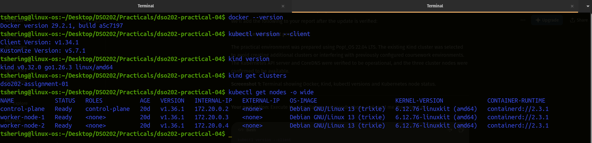
*Screenshot 1: Kubernetes cluster nodes showing all three nodes in Ready status*

### 5.3 Namespace Configuration

The `argocd` namespace was used to install Argo CD. The `demo-app` namespace was configured as the destination for the sample web application.

The existing coursework namespaces were left unchanged.

## 6. Practical Implementation

### 6.1 Installing Argo CD

Argo CD was installed in a dedicated Kubernetes namespace named `argocd`.

The namespace was created using:

```bash
kubectl create namespace argocd
```

The official stable Argo CD installation manifest was initially applied using:

```bash
kubectl apply -n argocd \
  -f https://raw.githubusercontent.com/argoproj/argo-cd/stable/manifests/install.yaml
```

During the initial installation, most Argo CD resources were successfully created. However, the installation encountered an error while creating the ApplicationSet Custom Resource Definition.

The error indicated that the metadata annotation exceeded the maximum permitted size:

```text
The CustomResourceDefinition "applicationsets.argoproj.io" is invalid:
metadata.annotations: Too long: may not be more than 262144 bytes
```

This occurred because the client-side apply operation attempted to store a large previous configuration in an annotation.

To address the issue, the installation manifest was prepared for reapplication using server-side apply:

```bash
kubectl apply -n argocd --server-side --force-conflicts \
  -f https://raw.githubusercontent.com/argoproj/argo-cd/stable/manifests/install.yaml
```

Server-side apply allows Kubernetes to manage the applied configuration without relying on the same large client-side last-applied annotation.

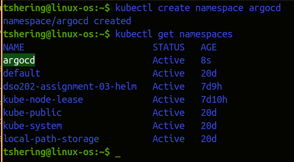
*Screenshot 2: Argo CD namespace created*

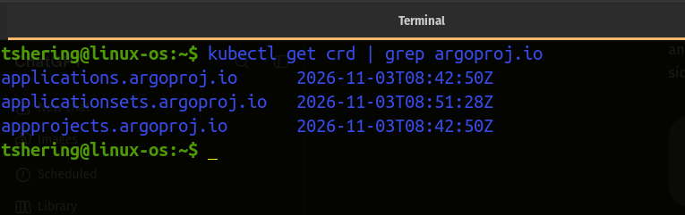
*Screenshot 3: Successful CRD verification*

### 6.2 Verifying Argo CD Pods and Services

After the installation resources were created, the Argo CD Pods were checked using:

```bash
kubectl wait --for=condition=Ready pods --all \
  -n argocd --timeout=300s
```

The Pods were then listed using:

```bash
kubectl get pods -n argocd
```

The observed output showed seven Argo CD Pods in the `Running` state with `1/1` containers ready.

The main components included:

- argocd-application-controller
- argocd-applicationset-controller
- argocd-dex-server
- argocd-notifications-controller
- argocd-redis
- argocd-repo-server
- argocd-server

The Argo CD Services were also checked:

```bash
kubectl get svc -n argocd
```

The `argocd-server` Service was available internally through a ClusterIP address and exposed ports 80 and 443.

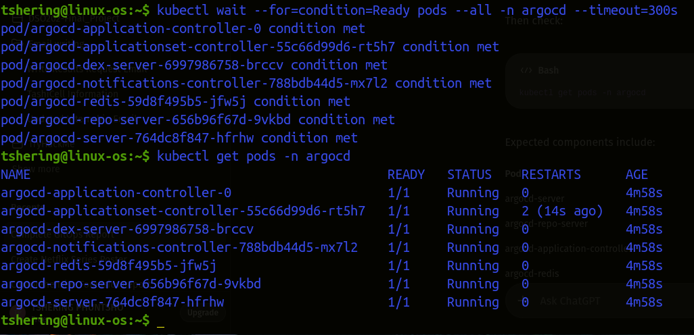
*Screenshot 4: Argo CD Pods showing Running and Ready status*

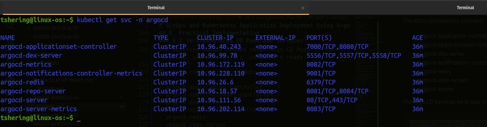
*Screenshot 5: Argo CD Services in the argocd namespace*

### 6.3 Accessing the Argo CD Dashboard

Since the Argo CD server was exposed internally through a ClusterIP Service, port forwarding was used to access its web interface from the local machine.

The initial admin password was retrieved using:

```bash
kubectl -n argocd get secret argocd-initial-admin-secret \
  -o jsonpath="{.data.password}" | base64 -d
```

Port forwarding was started using:

```bash
kubectl port-forward svc/argocd-server \
  -n argocd 8080:443
```

The dashboard was accessed through:

```text
https://localhost:8080
```

The administrator account was used to log in.

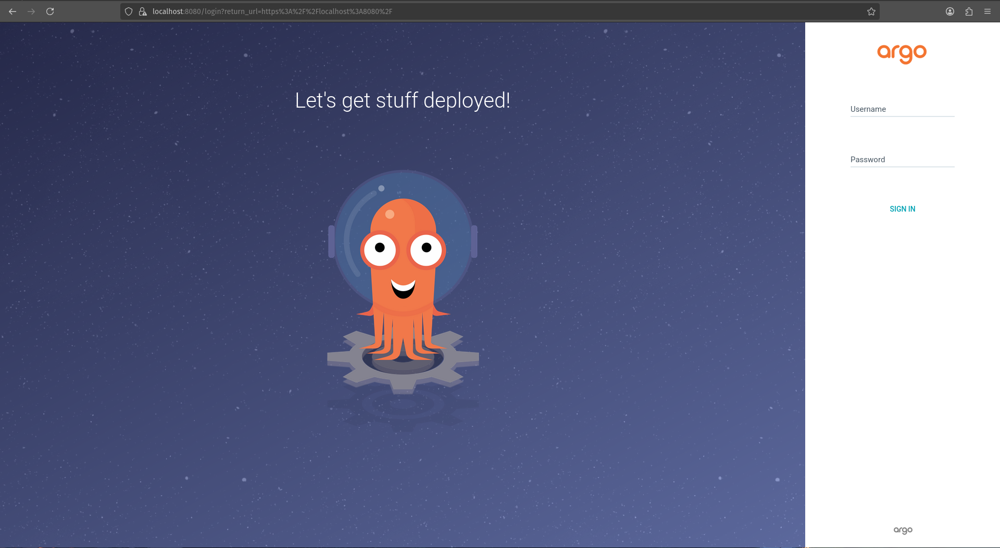
*Screenshot 6: Argo CD login page*

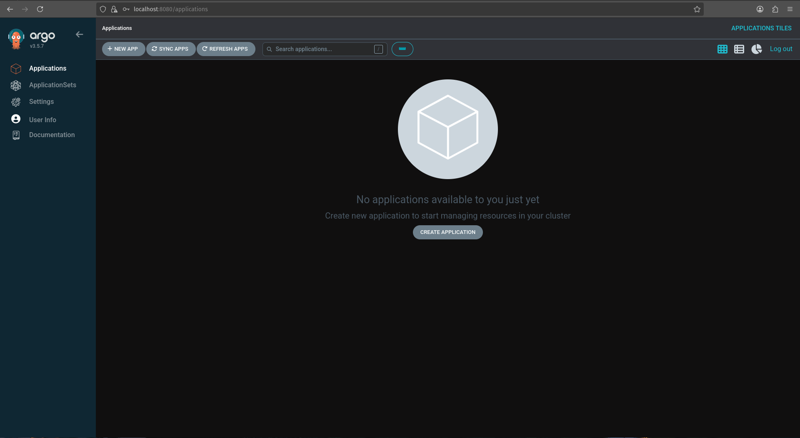
*Screenshot 7: Argo CD dashboard after successful login*

### 6.4 Creating the GitHub Configuration Repository

A public GitHub repository named `dso202-gitops-demo` was created to store the Kubernetes configuration files.

Repository Link: https://github.com/tsheringphuntsho18/dso202-gitops-demo/tree/main 

The repository was cloned locally using:

```bash
git clone https://github.com/tsheringphuntsho18/dso202-gitops-demo.git
```

The working directory was opened:

```bash
cd dso202-gitops-demo
```

A directory named `manifests` was created to store the Kubernetes YAML configuration files:

```bash
mkdir manifests
```

The repository structure was:

```text
dso202-gitops-demo/
├── README.md
└── manifests/
    ├── deployment.yaml
    └── service.yaml
```

This repository served as the source of truth for the desired application configuration.

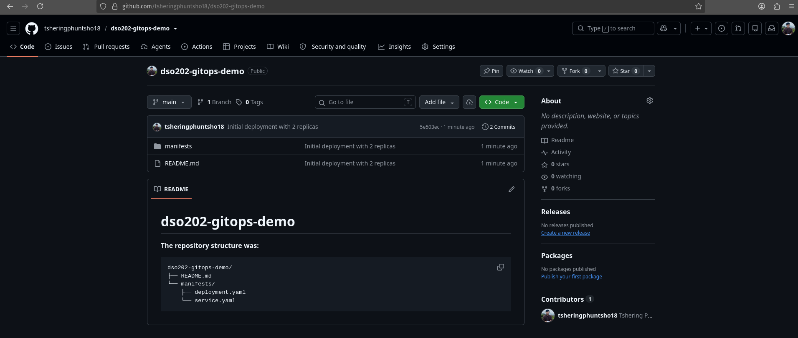
*Screenshot 8: GitHub repository showing the manifests directory and its files*

### 6.5 Creating the Deployment Manifest

A file named `deployment.yaml` was created inside the `manifests` directory.

The Deployment configuration was:

```yaml
apiVersion: apps/v1
kind: Deployment
metadata:
  name: webapp-deploy
  labels:
    app: webapp
spec:
  replicas: 2
  selector:
    matchLabels:
      app: webapp
  template:
    metadata:
      labels:
        app: webapp
    spec:
      containers:
        - name: webapp
          image: nginxdemos/hello:plain-text
          ports:
            - containerPort: 80
```

The Deployment defined a web application named `webapp-deploy`.

The configuration specified two replicas of the `nginxdemos/hello:plain-text` container image. The application container was configured to listen on port 80.

The Deployment controller was responsible for maintaining the requested number of application Pods.

### 6.6 Creating the Service Manifest

A second file named `service.yaml` was created to expose the application internally within the Kubernetes cluster.

The Service configuration was:

```yaml
apiVersion: v1
kind: Service
metadata:
  name: webapp-svc
spec:
  selector:
    app: webapp
  ports:
    - protocol: TCP
      port: 80
      targetPort: 80
  type: ClusterIP
```

The Service was configured with the `ClusterIP` type. It selected Pods labelled `app: webapp` and forwarded traffic from port 80 to the container's port 80.

This allowed the application Pods to be accessed through a stable internal Kubernetes Service.

### 6.7 Committing and Pushing the Configuration to GitHub

After creating both YAML manifests, the files were added to Git:

```bash
git add .
```

A commit was created:

```bash
git commit -m "Initial deployment with 2 replicas"
```

The configuration was pushed to the remote repository:

```bash
git push origin main
```

This made the Deployment and Service configuration available to Argo CD.

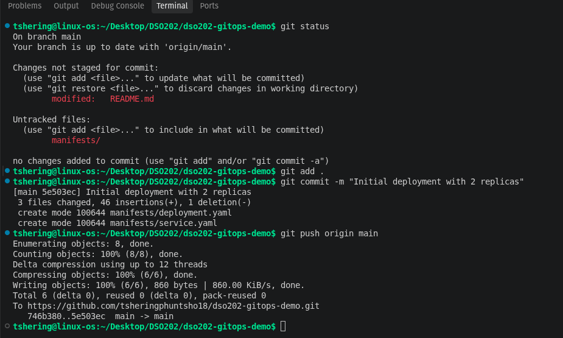
*Screenshot 9: Git commit and push operation*

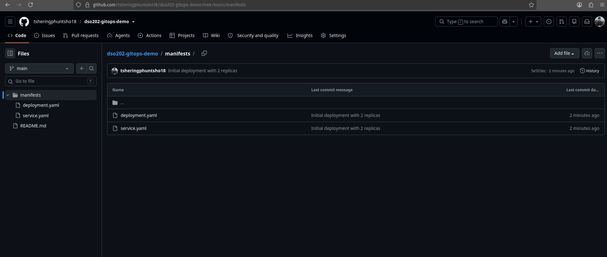
*Screenshot 10: GitHub showing deployment.yaml and service.yaml*

### 6.8 Creating the Argo CD Application

An Argo CD Application resource was created to connect the GitHub repository to the Kubernetes cluster.

The configuration was saved in a file named `argocd-app.yaml`.

```yaml
apiVersion: argoproj.io/v1alpha1
kind: Application
metadata:
  name: my-webapp
  namespace: argocd
spec:
  project: default

  source:
    repoURL: https://github.com/tsheringphuntsho18/dso202-gitops-demo.git  
    targetRevision: HEAD
    path: manifests

  destination:
    server: https://kubernetes.default.svc
    namespace: demo-app

  syncPolicy:
    automated:
      prune: true
      selfHeal: true
    syncOptions:
      - CreateNamespace=true
```

The Application was deployed using:

```bash
kubectl apply -f argocd-app.yaml
```

The configuration connected Argo CD to the public GitHub repository and instructed it to retrieve the manifests from the `manifests` directory.

The destination namespace was configured as `demo-app`. The `CreateNamespace=true` option allowed Argo CD to create the namespace automatically if it did not already exist.

Automated synchronization, pruning and self-healing were enabled.

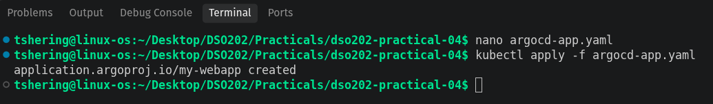
*Screenshot 11: Applying the Argo CD Application manifest*

### 6.9 Verifying the Application Deployment

After creating the Application resource, the Argo CD dashboard was refreshed to display the newly registered application named `my-webapp`.

The application resource tree was inspected to verify the relationship between the Argo CD Application, Deployment, ReplicaSet, Pods and Service.

The deployed resources were checked using:

```bash
kubectl get all -n demo-app
```

The Pods were inspected using:

```bash
kubectl get pods -n demo-app -o wide
```

The expected initial state was two running application Pods managed by the Deployment, along with the `webapp-svc` Service.

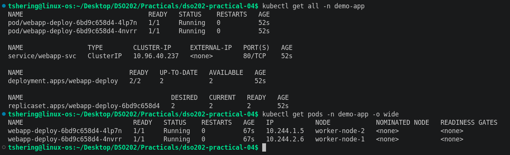
*Screenshot 12: Two application Pods and the Service in demo-app*

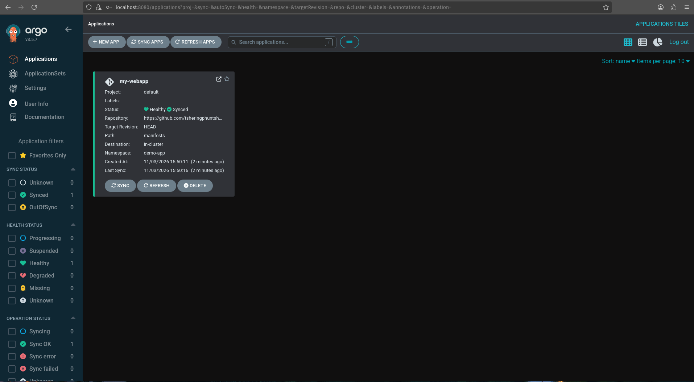
*Screenshot 13: my-webapp application in the Argo CD dashboard*

### 6.10 Testing GitOps Scaling

To demonstrate GitOps-based scaling, the Deployment manifest in the GitHub repository was modified.

The initial configuration contained:

```yaml
replicas: 2
```

This value was changed to:

```yaml
replicas: 4
```

The updated configuration was committed and pushed to GitHub.

Argo CD detected the change in the repository and synchronized the Kubernetes Deployment with the updated desired state.

The resulting Deployment was verified using:

```bash
kubectl get deployment webapp-deploy -n demo-app
```
The expected result was four ready replicas.  
**Output:**  
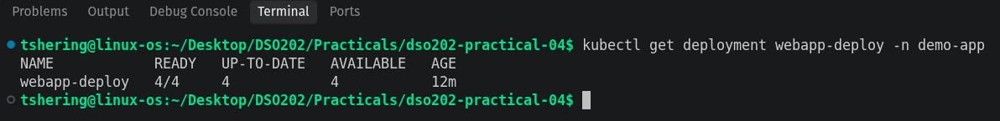

This demonstrated that application scaling could be controlled by modifying the desired configuration in Git instead of manually changing the Kubernetes Deployment.

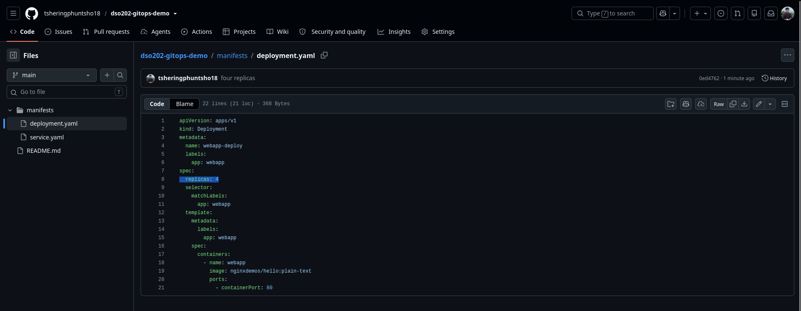
*Screenshot 14: GitHub Deployment manifest showing four replicas*

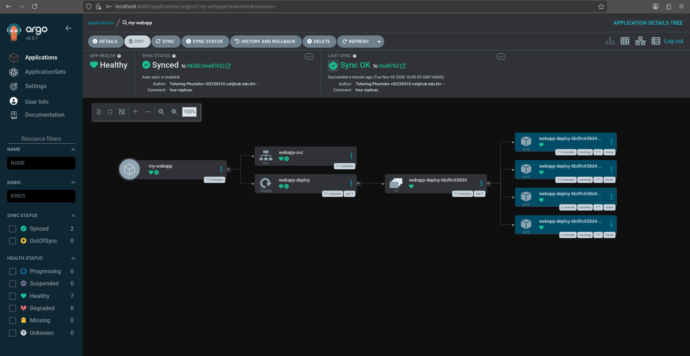
*Screenshot 15: Argo CD showing the synchronized application with four Pods*

### 6.11 Testing the Self-Healing Mechanism

The self-healing functionality of Argo CD was tested by manually changing the Deployment replica count in Kubernetes.

The Git repository still specified four replicas. However, the Deployment was manually scaled down to one replica using:

```bash
kubectl scale deployment webapp-deploy \
  -n demo-app --replicas=1
```

This introduced configuration drift because the actual cluster state no longer matched the desired state stored in Git.

Since `selfHeal: true` was enabled in the Argo CD Application configuration, Argo CD was expected to detect the difference and restore the Deployment to four replicas.

The Deployment was checked again using:

```bash
kubectl get deployment webapp-deploy -n demo-app
```

The expected final state was four ready replicas.

This experiment demonstrated that Argo CD can automatically correct unauthorized or unintended manual changes to Kubernetes resources.

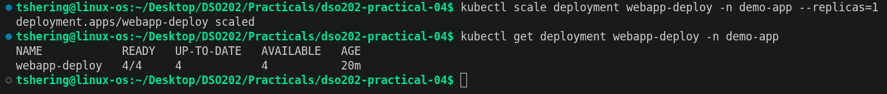
*Screenshot 16: Manual scaling of the Deployment to one replica*

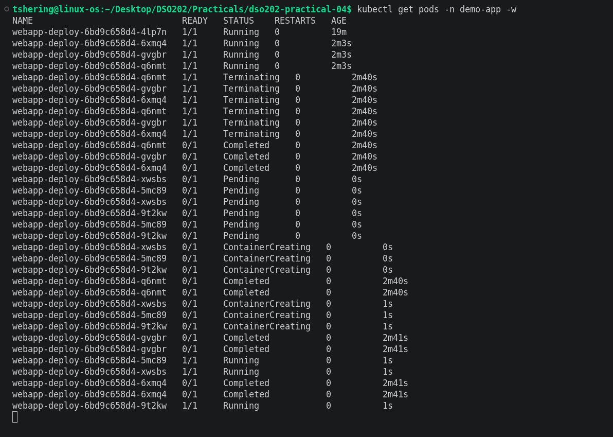
*Screenshot 17: Deployment restored to four replicas by Argo CD*

### 6.12 Testing the Pruning Mechanism

The pruning functionality was tested by removing the Service manifest from the GitHub repository.

The file:

```text
manifests/service.yaml
```

was deleted from the repository and the deletion was committed to GitHub.

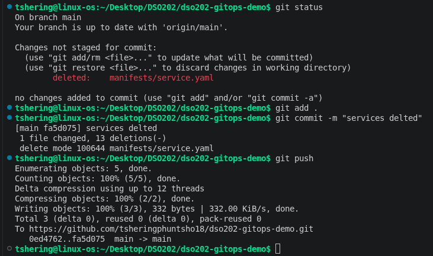

After Argo CD detected the change, it compared the repository configuration with the existing Kubernetes resources.

Since `prune: true` was enabled, Argo CD was expected to delete the corresponding Service from the Kubernetes cluster.

The Service resources were checked using:

```bash
kubectl get services -n demo-app
```

The `webapp-svc` Service was expected to be absent after successful pruning.

The Deployment and its Pods remained managed because their manifest was still present in the Git repository.

This demonstrated how Argo CD automatically removes resources that are no longer part of the desired configuration.

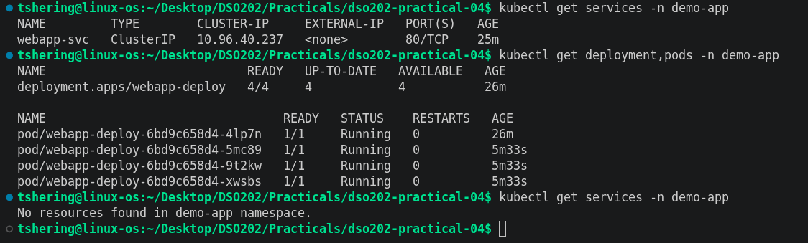
*Screenshot 18: Kubernetes services after deleting service.yaml*

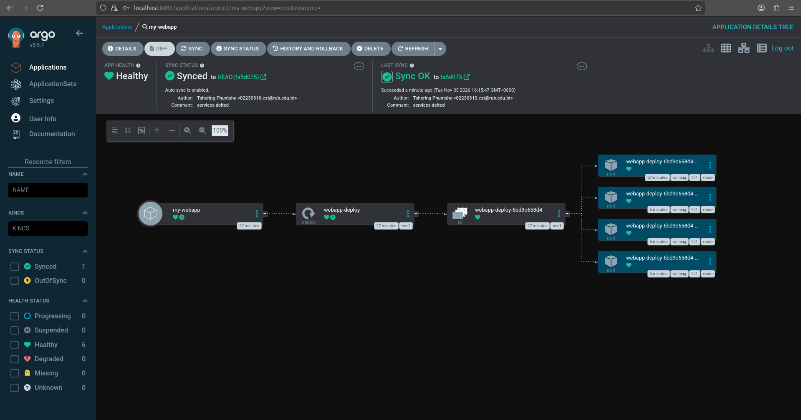
*Screenshot 19: Argocd after successful pruning*

### 6.13 Restoring the Deleted Service (Optional)

The deleted Service could be restored by reverting the Git commit that removed the Service manifest.

After restoring the file in Git and pushing the change, Argo CD would detect the updated repository state and recreate the Service in Kubernetes.

The Service could then be verified using:

```bash
kubectl get services -n demo-app
```
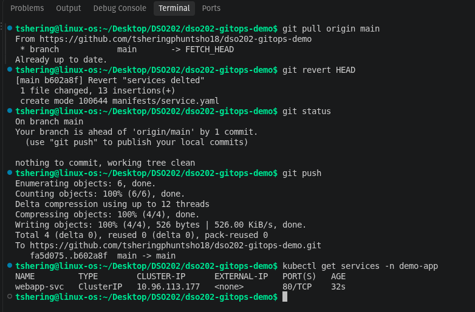
*Screenshot 20: Restored Service in the demo-app namespace*

## 7. Results and Observations

The practical was designed to demonstrate how Argo CD manages Kubernetes resources through GitOps.

The following table summarizes the observations to record after completing the corresponding tests.

| Experiment | Expected Observation |
|---|---|
| Argo CD installation | Argo CD components and required CRDs are available |
| Dashboard access | Argo CD web dashboard is accessible through port forwarding |
| Initial deployment | Two application Pods and one Service are created |
| Git-based scaling | Updating replicas from two to four results in four Pods |
| Self-healing | A manual reduction to one replica is corrected to four |
| Pruning | Deleting `service.yaml` from Git causes the Service to be removed |
| Service restoration | Reverting the deletion recreates the Service |

The initial Argo CD installation created its main resources and the seven Argo CD Pods reached the `Running` state with all containers ready. However, the initial installation encountered a Custom Resource Definition annotation-size error for the ApplicationSet CRD. Server-side reapplication was identified as the remediation and requires final verification.

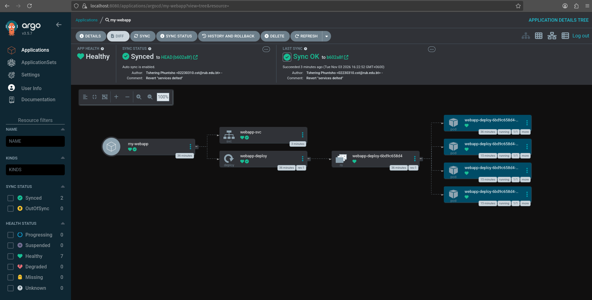
*Screenshot 21: Final Argo CD application status showing Synced and Healthy*

## 8. Challenges Encountered

### 8.1 ApplicationSet CRD Installation Error

During the initial Argo CD installation, Kubernetes rejected the ApplicationSet CRD because the metadata annotation exceeded the permitted size of 262144 bytes.

This prevented that particular CRD from being created through the initial client-side apply operation.

The proposed solution was to reapply the official Argo CD installation manifest using server-side apply with the `--force-conflicts` option.

### 8.2 Kubernetes Client and Server Version Difference

The local `kubectl` client was version `v1.34.1`, while the Kubernetes API server was version `v1.36.1`.

This represented a two-minor-version difference. Kubernetes generally supports `kubectl` within one minor version of the API server, so the version difference was noted as a compatibility consideration.

The practical was continued using the existing environment, with caution when executing Kubernetes commands.

### 8.3 Accessing the Argo CD Dashboard

The Argo CD server was exposed through a ClusterIP Service, which was not directly accessible from the local browser.

Port forwarding was used to securely access the dashboard through the local machine at `https://localhost:8080`.

The browser also displayed a certificate warning because the default Argo CD installation uses a self-signed certificate.

## 9. Discussion

This practical demonstrates how GitOps changes the way Kubernetes applications are deployed and managed.

Instead of directly applying every change to the cluster, the desired application configuration is maintained in a Git repository. Argo CD continuously monitors this repository and reconciles the Kubernetes cluster with the declared configuration.

The Git-based scaling experiment demonstrates that changing the replica count in the repository can automatically update the running application. This makes deployment changes traceable and repeatable.

The self-healing experiment demonstrates the importance of continuous reconciliation. If someone manually changes a Kubernetes resource, Argo CD can detect the difference and restore the configuration according to the Git repository.

Similarly, the pruning experiment demonstrates how deleted configuration files can cause their corresponding Kubernetes resources to be removed automatically.

Overall, these capabilities help reduce configuration drift, improve deployment consistency and provide better visibility into application deployment changes.

## 10. Conclusion

The practical introduced the concepts of GitOps and demonstrated how Argo CD can be used to manage Kubernetes application deployments through a Git repository.

A Kind Kubernetes cluster was used as the execution environment, and Argo CD was installed in a dedicated namespace. A GitHub repository was prepared to store the Kubernetes Deployment and Service manifests, and an Argo CD Application was configured to synchronize these resources with the cluster.

The practical activities also covered automated synchronization, Git-based scaling, self-healing and pruning. These features demonstrate how Argo CD continuously maintains the desired application state defined in Git.

Through this practical, the importance of declarative configuration, version control and automated reconciliation in modern Kubernetes application management was explored.

## 11. References

1. GitOps and Argo CD Lab Guide – HackMD, provided practical material.
2. Argo CD Official Documentation: https://argo-cd.readthedocs.io/
3. Kubernetes Documentation: https://kubernetes.io/docs/
4. Kind Documentation: https://kind.sigs.k8s.io/
5. Git Documentation: https://git-scm.com/doc

