# DSO202 — Practical_5 Report

##  Kubernetes Configuration Management Using Kustomize

**Module:** DSO202 — Scaling, Orchestration, Monitoring & Observability  
**Programme:** BE in Software Engineering  
**Practical:** 05 of 10  
**Student Name:** Tshering Phuntsho  
**Student Number:** 02230310   
**Date:** 29 September, 2026

## 1. Introduction

Kustomize is a configuration management tool used to customise Kubernetes resource manifests without modifying the original base configuration. It allows users to maintain a common set of Kubernetes resources and apply environment-specific configurations through overlays.

In this practical, Kustomize was used to manage a web application across four environments: development, staging, production, and QA. Instead of creating separate Deployment and Service manifests for each environment, a shared base configuration was created and customised using overlays.

The practical also demonstrated ConfigMap generation, automatic hash suffix changes, resource patches, and the workflow of rendering, comparing, applying, and verifying Kubernetes configurations.

## 2. Objectives

The objectives of this practical were:

1. Understand the concept and purpose of Kustomize.
2. Create a shared base configuration containing Kubernetes resources.
3. Create multiple overlays for development, staging, production, and QA.
4. Customise namespaces, labels, replica counts, and web content for different environments.
5. Understand how Kustomize generates ConfigMaps with hash suffixes.
6. Observe how ConfigMap changes trigger Deployment rollouts.
7. Apply production-specific resource requests and limits using a patch.
8. Use a JSON 6902 patch to add an annotation to the QA Deployment.
9. Follow the safe workflow of render, diff, apply, and verify.
10. Clean up the resources created during the practical.

## 3. Tools and Technologies

The following tools and technologies were used:

| Tool/Technology | Purpose |
|---|---|
| Kubernetes | Container orchestration |
| Kind | Running a local Kubernetes cluster |
| kubectl | Managing Kubernetes resources |
| Kustomize | Customising Kubernetes manifests |
| NGINX | Web server used for the demonstration |
| Linux Terminal | Executing commands and managing files |

## 4. Environment Setup

The practical was performed using the existing Kind cluster from the previous practicals.

**Environment details:**

| Component | Version/Configuration |
|---|---|
| Operating System | Pop!_OS 22.04 LTS |
| Docker | 29.2.1 |
| Kind | v0.32.0 |
| kubectl | v1.34.1 |
| Kubernetes Cluster | Existing Kind cluster |
| Cluster Nodes | Control-plane and two worker nodes |

The cluster was verified using the following commands:

```bash
kubectl config current-context
kubectl cluster-info
kubectl get nodes -o wide
kubectl version --client -o yaml
```

All cluster nodes were checked to ensure that they were in the `Ready` state before proceeding.

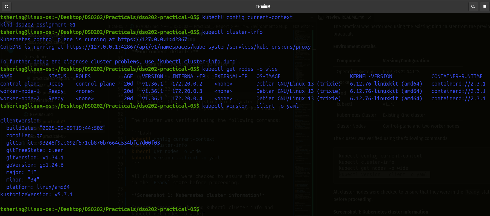
*Screenshot 1: Kubernetes cluster information*

## 5. Repository Structure

A new repository directory was created to organise the practical files, manifests, evidence, and report.

The repository structure was:

```text
.   
├── cluster    
│   └── kind-cluster.yaml  
├── evidence  
│   ├── ...
│   └── screenshots/  
├── examples  
│   └── webapp  
│       ├── base/  
│       └── overlays  
│           ├── dev/  
│           ├── prod/  
│           ├── qa/  
│           └── staging/  
├── README.md  
└── report  
    └── practical-05-report.md  
```

The `base` directory contains the common Kubernetes resources, while the `overlays` directory contains environment-specific configurations. The `evidence` directory stores command outputs and other practical evidence.


## 6. Creating the Base Configuration

The base configuration was created inside `examples/webapp/base/`. It contained the Deployment, Service, HTML page, and Kustomization configuration.

### 6.1 Deployment

The `deployment.yaml` file defined the web application Deployment using the NGINX container image.

The Deployment specified:

- Application name: `webapp`
- Container name: `nginx`
- Container image: `nginx:1.27`
- Container port: `80`
- A volume mount for the generated web content ConfigMap

### 6.2 Service

The `service.yaml` file defined a ClusterIP Service named `webapp`. It exposed port 80 and forwarded traffic to port 80 of the application Pods.

### 6.3 ConfigMap Generation

The base `kustomization.yaml` file used the `configMapGenerator` feature to generate a ConfigMap from `index.html`.

The generated ConfigMap was referenced by the Deployment so that NGINX could serve the HTML page.

### 6.4 Rendering the Base

The base configuration was rendered using:

```bash
kubectl kustomize examples/webapp/base
```

The output was inspected to identify the Deployment, Service, generated ConfigMap, and the ConfigMap reference inside the Deployment.

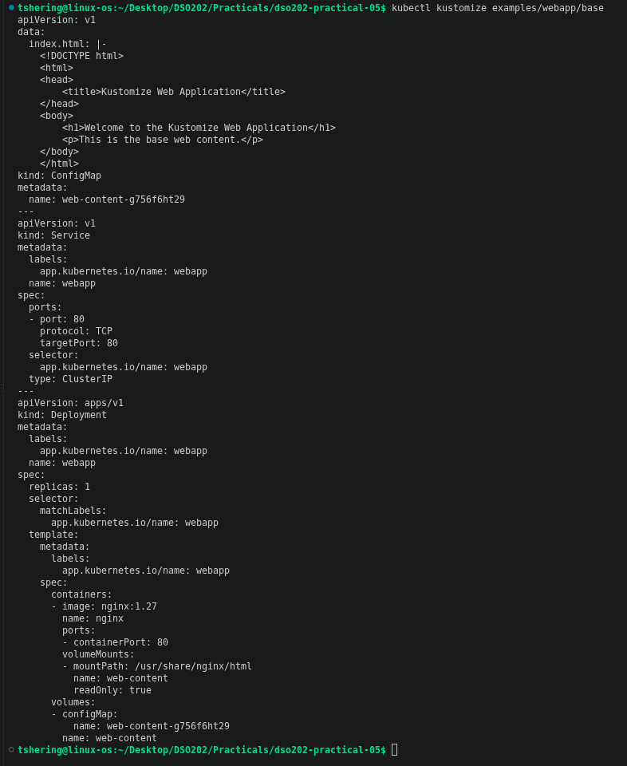
*Screenshot 2: Rendered base configuration*

### 6.5 ConfigMap Hash Suffix

The generated ConfigMap name contained a hash suffix rather than being exactly `web-content`.

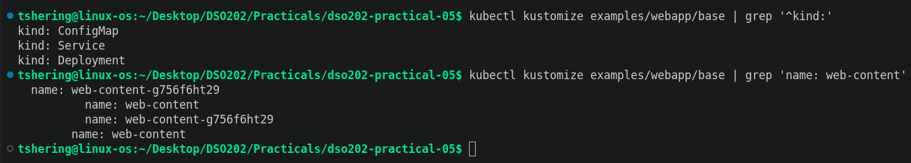
**Screenshot 3: Rendered base using filters**

Kustomize generates this suffix based on the ConfigMap content. This helps Kubernetes detect changes in the configuration. When the content changes, the generated name also changes, and Kustomize updates the Deployment reference accordingly.

## 7. Creating Environment Overlays

Separate overlays were created for development, staging, and production. Each overlay reused the base resources and introduced environment-specific configurations.

### 7.1 Development Overlay

The development overlay used the namespace `webapp-dev`.

Its configuration included:

- Namespace: `webapp-dev`
- Environment label: `dev`
- Replica count: 1
- Development-specific HTML content

The overlay reused the base Deployment and Service while replacing the generated ConfigMap content with the development-specific `index.html`.

### 7.2 Staging Overlay

The staging overlay used the namespace `webapp-staging`.

Its configuration included:

- Namespace: `webapp-staging`
- Environment label: `staging`
- Replica count: 2
- Staging-specific HTML content

### 7.3 Production Overlay

The production overlay used the namespace `webapp-prod`.

Its configuration included:

- Namespace: `webapp-prod`
- Environment label: `prod`
- Replica count: 3
- Production-specific HTML content
- CPU and memory resource requests and limits

A separate file named `patch-resources.yaml` was created to apply production-specific resource settings to the Deployment.

This approach allowed production-specific settings to be introduced without copying the entire base Deployment manifest.

## 8. Rendering and Comparing Environments

The development and production overlays were rendered into separate YAML files.

```bash
kubectl kustomize examples/webapp/overlays/dev \
  > evidence/dev-rendered.yaml

kubectl kustomize examples/webapp/overlays/prod \
  > evidence/prod-rendered.yaml
```

The rendered configurations were compared using:

```bash
diff -u evidence/dev-rendered.yaml evidence/prod-rendered.yaml
```

The comparison demonstrated the differences between the two environments.

The main differences included:

1. **Namespace:** Development used `webapp-dev`, while production used `webapp-prod`.
2. **Environment label:** The development environment used `dev`, while production used `prod`.
3. **Replica count:** Development used one replica, while production used three.
4. **Web content:** Each environment used its own HTML content, resulting in different generated ConfigMap content and hash suffixes.
5. **Resource configuration:** Production included CPU and memory requests and limits.

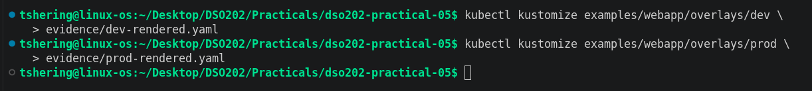
*Screenshot 4: Development rendered output*

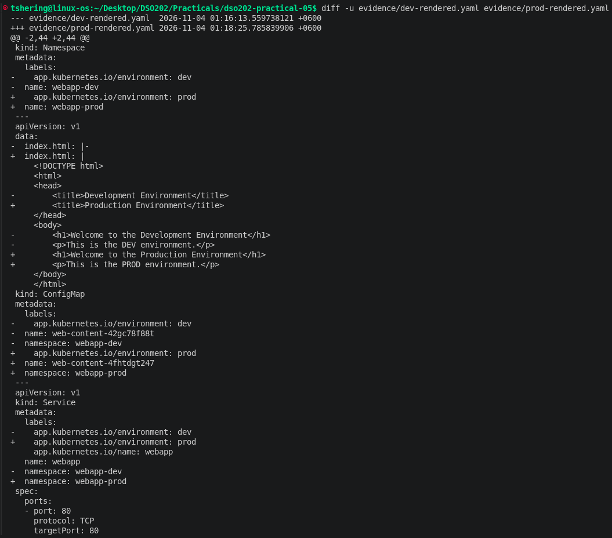
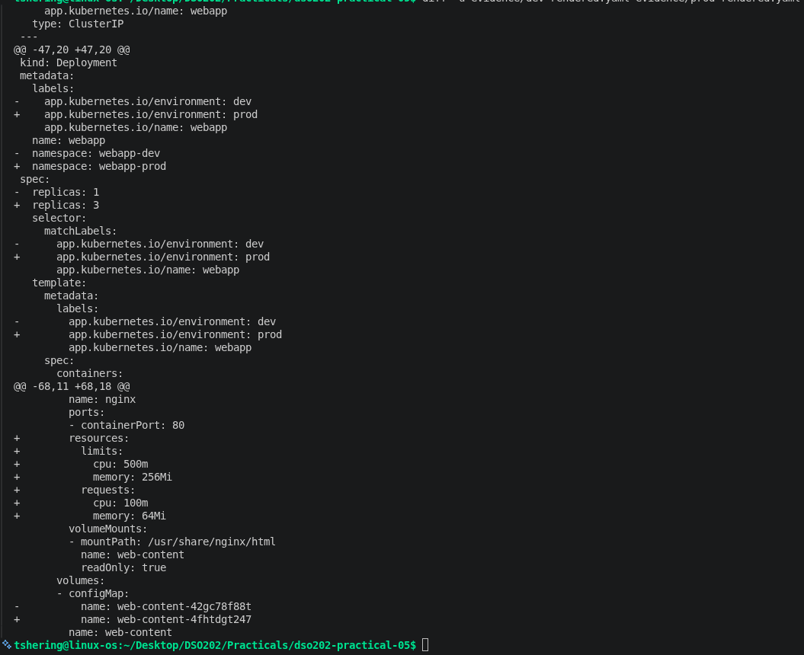
*Screenshot 5: Development and production comparison*

## 9. Deploying the Development Environment

Before deploying the development environment, the rendered configuration was inspected.

The following commands were used:

```bash
kubectl kustomize examples/webapp/overlays/dev

kubectl diff -k examples/webapp/overlays/dev

kubectl apply -k examples/webapp/overlays/dev
```

After applying the configuration, the resources were verified:

```bash
kubectl get all -n webapp-dev

kubectl get configmap -n webapp-dev

kubectl rollout status deployment/webapp -n webapp-dev
```

The Deployment, Pods, Service, and generated ConfigMap were inspected to verify that the development environment had been created successfully.

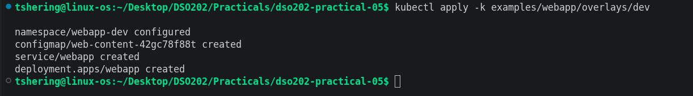
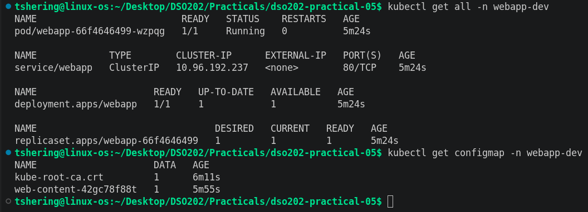
*Screenshot 6: Development environment resources*

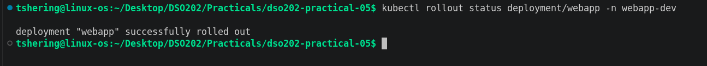
*Screenshot 7: Development Deployment rollout*

## 10. Testing the Development Web Application

The development application was tested using Kubernetes port-forwarding.

The following command was executed:

```bash
kubectl port-forward -n webapp-dev service/webapp 8080:80
```

In another terminal, the application was accessed using:

```bash
curl http://127.0.0.1:8080
```

The returned HTML content was inspected to confirm that the development-specific page was being served.

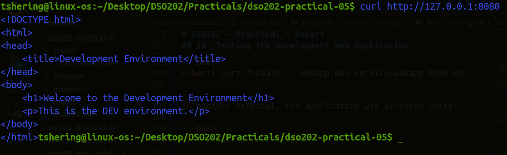
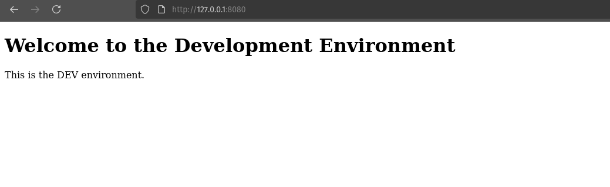
**Screenshot 8: Development web application response**

## 11. ConfigMap Hash Behaviour and Deployment Rollout

One of the main objectives of this practical was to understand how Kustomize handles changes to generated ConfigMaps.

Initially, the ConfigMap and Pod information was recorded using:

```bash
kubectl get configmap -n webapp-dev

kubectl get pods -n webapp-dev -o wide
```

The development `index.html` file was then modified by changing its heading to:

```html
<h1>DEV v2 — configuration changed</h1>
```

Before applying the changes, the generated ConfigMap name was inspected again:

```bash
kubectl kustomize examples/webapp/overlays/dev \
  | grep 'name: web-content'
```

After the content change, the overlay was applied again:

```bash
kubectl apply -k examples/webapp/overlays/dev

kubectl rollout status deployment/webapp -n webapp-dev
```

The ConfigMap and Pod information was collected again.

### 11.1 Observed Behaviour

The change followed this sequence:

1. The content of `index.html` was modified.
2. Kustomize generated a ConfigMap containing the updated content.
3. The generated ConfigMap name received a new hash suffix.
4. The Deployment's ConfigMap reference was updated.
5. The Deployment Pod template changed.
6. Kubernetes triggered a rollout to create Pods using the updated configuration.

This demonstrated how Kustomize's generated ConfigMap hash helps Kubernetes recognise configuration changes and update the affected workload.

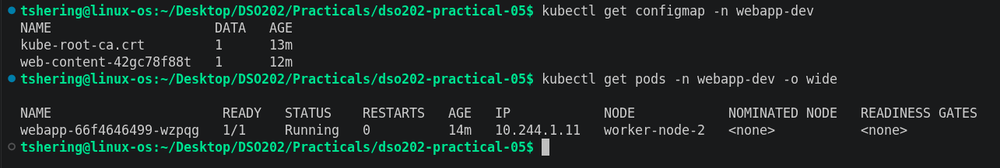
*Screenshot 9: ConfigMap before the content change*

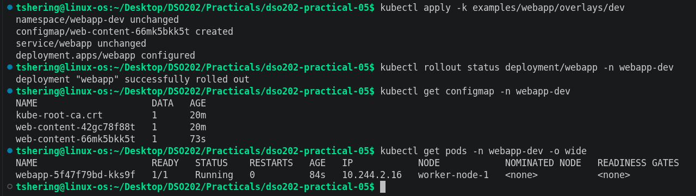
*Screenshot 10: ConfigMap after the content change*

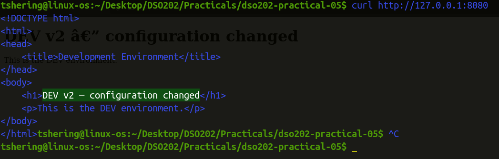
*Screenshot 11: Updated development web application response*

## 12. Deploying Staging and Production

After verifying the development environment, the staging and production overlays were deployed.

The staging environment was deployed using:

```bash
kubectl diff -k examples/webapp/overlays/staging

kubectl apply -k examples/webapp/overlays/staging
```

The production environment was deployed using:

```bash
kubectl diff -k examples/webapp/overlays/prod

kubectl apply -k examples/webapp/overlays/prod
```

The resources across all environments were inspected using:

```bash
kubectl get deploy -A -l app.kubernetes.io/name=webapp

kubectl get pods -A -l app.kubernetes.io/name=webapp -o wide
```

The expected replica configuration was:

| Environment | Namespace | Expected Replicas |
|---|---|---:|
| Development | `webapp-dev` | 1 |
| Staging | `webapp-staging` | 2 |
| Production | `webapp-prod` | 3 |

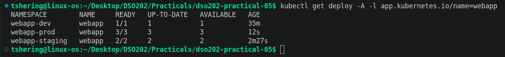
*Screenshot 12: Deployments across environments*

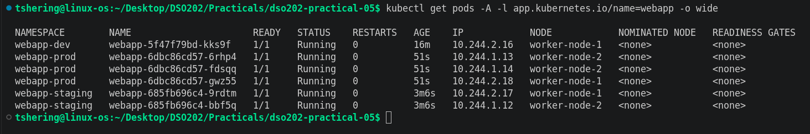
*Screenshot 13: Pods across environments*

## 13. Production Resource Patch

The production overlay included a `patch-resources.yaml` file to define CPU and memory requests and limits.

The configured values were:

| Resource | Request | Limit |
|---|---:|---:|
| CPU | 100m | 500m |
| Memory | 64Mi | 256Mi |

The rendered production configuration was inspected to confirm that these values appeared under the NGINX container's resource configuration.

The patch merged the specified resource settings into the existing Deployment instead of replacing the complete Deployment configuration.

The production overlay owns this resource policy because resource requirements can differ between environments.

Using a patch is better than copying the entire Deployment manifest into the production directory because it reduces duplication and makes the configuration easier to maintain.

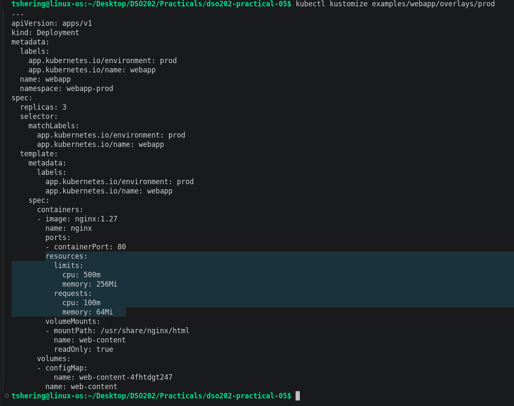
*Screenshot 14: Production resource configuration*

## 14. Creating the QA Overlay

A fourth overlay was created for the QA environment.

The QA overlay reused the same base Deployment and Service without duplicating either manifest.

Its configuration included:

- Namespace: `webapp-qa`
- Replica count: 2
- Environment label: `qa`
- Unique QA HTML content
- Deployment annotation: `training.example.com/owner: qa-team`

A JSON 6902 patch named `patch-annotation.yaml` was used to add the annotation to the Deployment's Pod template metadata.

The QA overlay was rendered using:

```bash
kubectl kustomize examples/webapp/overlays/qa
```

The rendered output was inspected to verify that the annotation appeared before applying the configuration.

The QA environment was then deployed:

```bash
kubectl diff -k examples/webapp/overlays/qa

kubectl apply -k examples/webapp/overlays/qa
```

The Deployment was inspected using:

```bash
kubectl get deployment webapp -n webapp-qa -o yaml
```

The output was checked to confirm that the annotation and replica configuration were present.

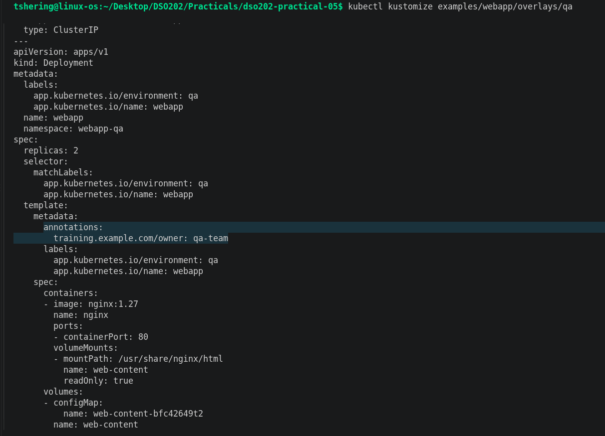
*Screenshot 15: QA rendered configuration*

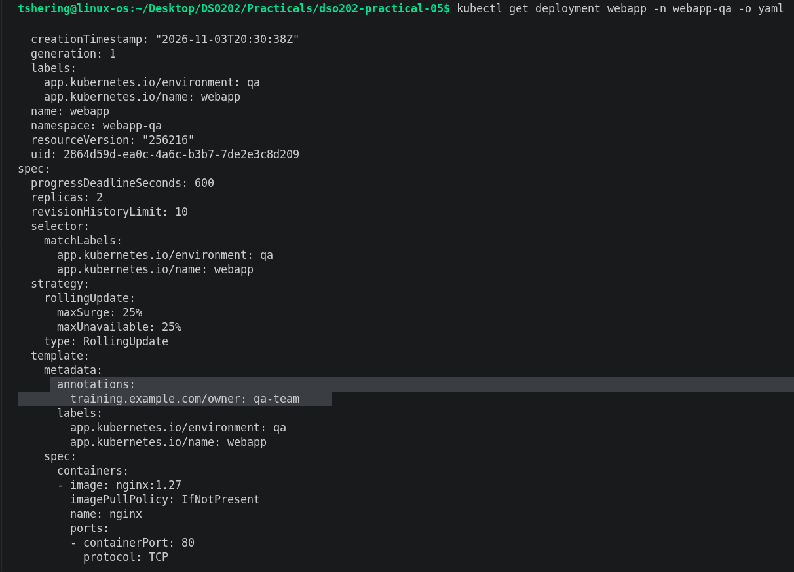
*Screenshot 16: QA Deployment verification*

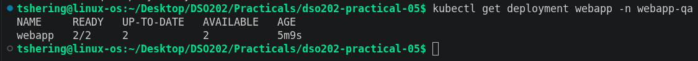
*Screenshot 17: QA replica count*

## 15. Strategic Merge Patch and JSON 6902 Patch

This practical demonstrated two approaches to modifying Kubernetes resources through Kustomize patches.

### 15.1 Strategic Merge Patch

A strategic merge patch uses Kubernetes resource fields to merge specified changes into an existing resource.

In this practical, it was used in the production overlay to add CPU and memory resource requests and limits to the NGINX container.

Only the required fields were specified, while the remaining base Deployment configuration was retained.

### 15.2 JSON 6902 Patch

A JSON 6902 patch uses explicit operations to modify a resource through JSON Pointer paths.

Common operations include:

- `add`
- `remove`
- `replace`

In this practical, the QA overlay used an `add` operation to introduce the annotation:

`training.example.com/owner: qa-team`

### 15.3 Comparison

| Strategic Merge Patch | JSON 6902 Patch |
|---|---|
| Uses Kubernetes resource structure | Uses explicit patch operations |
| Specifies fields to merge | Specifies operations and JSON Pointer paths |
| Suitable for structured resource changes | Suitable for precise modifications |
| Used for production resource settings | Used for the QA Deployment annotation |

Both approaches allow environment-specific changes without duplicating the complete base resource manifests.

## 16. Safe Kustomize Workflow

Throughout the practical, the following workflow was used:

1. **Render:** Use `kubectl kustomize` to inspect the final configuration generated from the base and overlay.
2. **Diff:** Use `kubectl diff -k` to compare the desired configuration with the current cluster state.
3. **Apply:** Use `kubectl apply -k` to deploy the configuration.
4. **Verify:** Use commands such as `kubectl get`, `kubectl describe`, and `kubectl rollout status` to confirm the deployment.

This workflow helps identify configuration problems before applying changes to the Kubernetes cluster.

## 17. Cleanup

After collecting the required evidence, all four environments created during the practical were removed.

The following commands were used:

```bash
kubectl delete -k examples/webapp/overlays/dev

kubectl delete -k examples/webapp/overlays/staging

kubectl delete -k examples/webapp/overlays/prod

kubectl delete -k examples/webapp/overlays/qa
```

The namespaces were then checked using:

```bash
kubectl get ns | grep 'webapp-' || true
```

This cleanup removed the practical's application resources without deleting the existing Kind cluster or resources belonging to previous practicals.

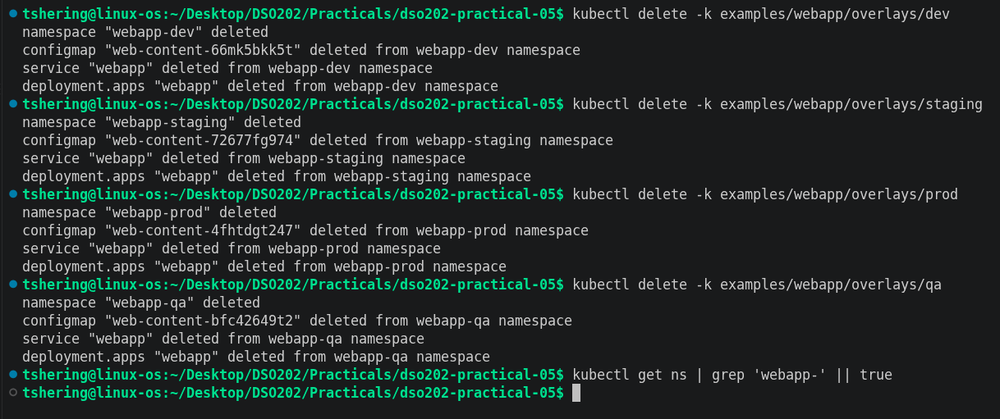
*Screenshot 18: Cleanup verification*

## 18. Results and Discussion

The practical demonstrated how Kustomize can be used to manage multiple Kubernetes environments through a shared base configuration and environment-specific overlays.

The development, staging, production, and QA overlays used the same base Deployment and Service while applying different namespaces, labels, replica counts, and web content.

The ConfigMap generation experiment demonstrated that changing the source HTML content changes the generated ConfigMap hash. Since the Deployment references the generated ConfigMap, the updated reference changes the Pod template and triggers a rollout.

The production patch demonstrated how environment-specific resource requests and limits can be introduced without maintaining a separate copy of the Deployment manifest. The QA overlay demonstrated how a JSON 6902 patch can add a specific annotation to an existing resource.

Overall, the practical showed the benefits of Kustomize in reducing manifest duplication, improving configuration consistency, and simplifying the management of Kubernetes resources across different environments.

## 19. Conclusion

In conclusion, this practical provided hands-on experience with Kustomize and its role in managing Kubernetes configurations.

By creating a shared base and multiple overlays, the same application resources were configured for development, staging, production, and QA without duplicating the Deployment and Service manifests.

The practical also provided an understanding of ConfigMap hash generation, automatic Deployment rollouts, strategic merge patches, JSON 6902 patches, and the safe workflow of rendering, comparing, applying, and verifying configurations.

These concepts are useful in real-world DevOps and DevSecOps workflows, where maintaining consistent and environment-specific Kubernetes configurations is important.

## 20. References

1. Practical 03: Kind Hands-on Lab — Kustomize instructions provided for the DSO202 practical.
2. Kubernetes Documentation — [https://kubernetes.io/docs/](https://kubernetes.io/docs/)
3. Kustomize Documentation — [https://kubectl.docs.kubernetes.io/](https://kubectl.docs.kubernetes.io/)
4. Kind Documentation — [https://kind.sigs.k8s.io/](https://kind.sigs.k8s.io/)
