# DSO202 — Practical_6 Report

## Create a Helm Chart for a Complex Application and Deploy It to Kubernetes

**Module:** DSO202 — Scaling, Orchestration, Monitoring & Observability  
**Programme:** BE in Software Engineering  
**Practical:** 06 of 10  
**Student Name:** Tshering Phuntsho  
**Student Number:** 02230310   
**Date:** 6 October, 2026

## 1. Introduction

This practical demonstrates the use of Helm to package, configure, validate and deploy a multi-component application on Kubernetes. Helm is the Kubernetes package manager. It uses charts containing metadata, default values and templates to create configurable Kubernetes resources. Each installation is managed as a release, and Helm records revisions that can be inspected, upgraded and rolled back.

The project implements a Credit Book demonstration application with three components: an Nginx frontend, a Node.js REST API and a PostgreSQL database. The application is packaged as an umbrella chart with three local subcharts.

## 2. Objectives

- Understand Helm charts, releases, revisions and values.
- Create a Helm umbrella chart with multiple subcharts.
- Use Go templates, named templates, helper functions and values.
- Deploy Deployments, Services and a PostgreSQL StatefulSet.
- Configure application settings through environment-specific values files.
- Handle database credentials through a Kubernetes Secret.
- Validate the chart using `helm lint`, `helm template` and server-side dry-run.
- Install, inspect, test, upgrade, roll back, package and uninstall a Helm release.

## 3. Tools and Environment

| Tool | Version / details |
|---|---|
| Operating system | Pop!_OS 22.04 LTS |
| Docker | 29.2.1 |
| Kind | v0.32.0 |
| kubectl client/server | v1.34.1 |
| Helm | v3.22.1 |
| Kubernetes cluster | Existing Kind cluster:  dso202-assignment-01 |

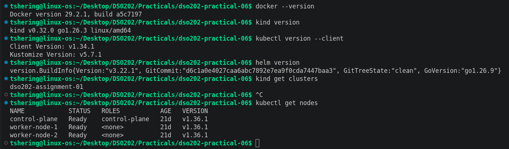
**Screenshot 1:** Tool versions and Kubernetes nodes.  

## 4. Application Architecture

The Credit Book application follows a three-tier architecture:

1. **Frontend:** Nginx serves the HTML user interface. It forwards `/api/` requests to the backend Service.
2. **Backend:** Node.js provides REST endpoints to check API/database health, list transactions and create transactions.
3. **Database:** PostgreSQL stores transaction records. It runs as a StatefulSet and can use a PersistentVolumeClaim.

The Helm umbrella chart groups the frontend, backend and database subcharts under one release.

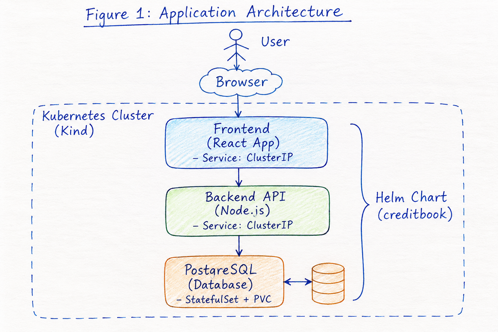
**Figure 1:** Application architecture.  

## 5. Project Structure

```text
dso202-practical-06/
├── app/
│   ├── backend/
│   │   ├── Dockerfile
│   │   ├── package.json
│   │   └── server.js
│   └── frontend/
│       ├── Dockerfile
│       ├── index.html
│       └── nginx.conf
├── charts/
│   └── creditbook/
│       ├── Chart.yaml
│       ├── values.yaml
│       ├── values.schema.json
│       ├── .helmignore
│       ├── templates/
│       │   ├── NOTES.txt
│       │   └── tests/
│       │       └── test-connection.yaml
│       └── charts-src/
│           ├── frontend/
│           ├── backend/
│           └── database/
├── environments/
│   ├── dev.yaml
│   └── prod.yaml
├── evidence/
├── dist/
├── report/
│   └── practical-06-report.md
└── README.md
```

## 6. Building and Loading Container Images

The frontend and backend have separate Dockerfiles. The frontend image is based on Nginx and includes the application interface and reverse-proxy configuration. The backend image is based on Node.js and installs the PostgreSQL client library.

Commands executed:

```bash
docker build -t creditbook-frontend:1.0.0 ./app/frontend
docker build -t creditbook-backend:1.0.0 ./app/backend
docker images | grep creditbook
kind load docker-image creditbook-frontend:1.0.0 --name [KIND_CLUSTER_NAME]
kind load docker-image creditbook-backend:1.0.0 --name [KIND_CLUSTER_NAME]
```
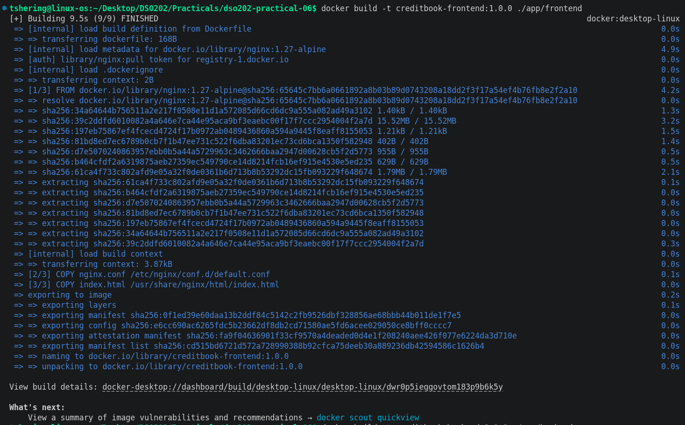
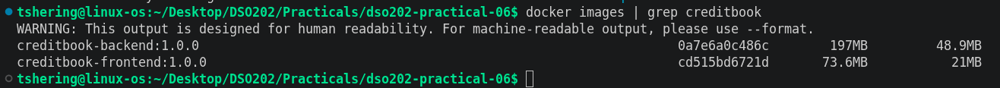
**Screenshot 2:** Docker image build and image list.  

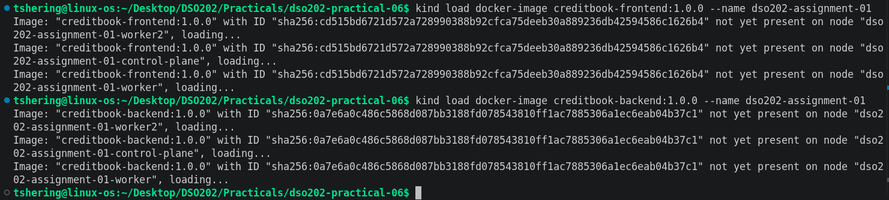
**Screenshot 3:** Successful image loading into Kind.

## 7. Helm Chart Design

The parent chart is named `creditbook`. Its `Chart.yaml` declares three local dependencies:

- `frontend` — serves the web interface.
- `backend` — provides the REST API.
- `database` — runs PostgreSQL.

The parent chart is an umbrella chart. It allows the complete application to be installed, upgraded and removed as one Helm release.

The chart uses `apiVersion: v2`, a chart version of `0.1.0` and application version `1.0.0`. Chart version and application version represent different things: the chart version identifies the package, while the application version identifies the software deployed.

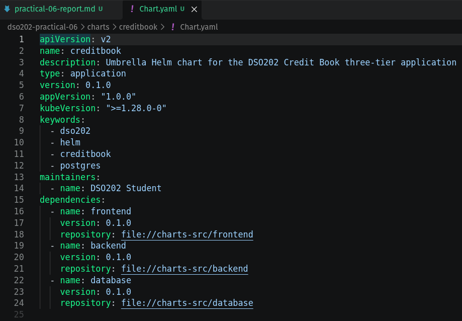
**Screenshot 4:** Parent `Chart.yaml` and subchart directory structure.

## 8. Helm Values and Configuration

The parent `values.yaml` defines default settings. The `environments/dev.yaml` and `environments/prod.yaml` files override the defaults.

The development environment uses one frontend and one backend replica. The production configuration preview uses two frontend and two backend replicas with higher resource requests and limits.

Helm merges values in this order: chart defaults, parent values for subcharts, values files from left to right, and command-line overrides. Therefore, the complete environment values file is supplied on each upgrade.

## 9. Secret Management

The database username, password and database name are stored in a Kubernetes Secret named `creditbook-db`. The chart only references the Secret using `secretKeyRef`; it does not place the password in the chart's values file or rendered manifests.

This is safer than committing a password to source control or passing it through a command-line `--set` flag. However, Kubernetes Secrets are not automatically encrypted merely because they are base64 encoded. Access must be controlled using RBAC and appropriate cluster security settings. Helm release values should also not contain confidential credentials because Helm stores release records in the cluster.

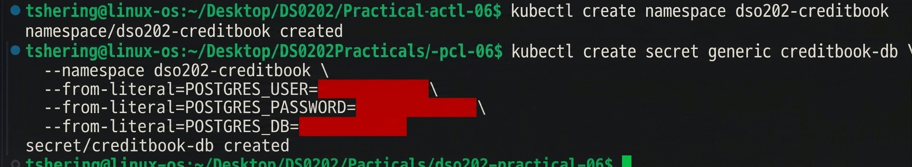
**Screenshot 5:** Secret metadata.

## 10. Dependency Resolution and Validation

The local subcharts were resolved using:

```bash
helm dependency update ./charts/creditbook
helm dependency list ./charts/creditbook
```

The chart was checked using:

```bash
helm lint ./charts/creditbook -f environments/dev.yaml
helm template creditbook ./charts/creditbook \
  --namespace dso202-creditbook \
  -f environments/dev.yaml \
  > evidence/rendered-dev.yaml
kubectl apply --dry-run=server \
  --namespace dso202-creditbook \
  -f evidence/rendered-dev.yaml
```

`helm lint` checks chart structure and common chart issues. `helm template` renders the templates locally using the selected values. The Kubernetes server-side dry-run checks whether the API server accepts the rendered resources without persisting them.

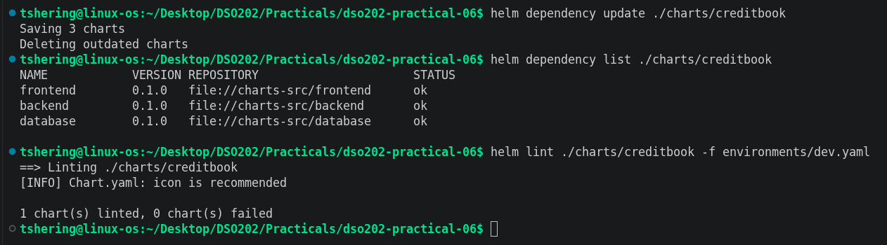
**Screenshot 6:** Dependency list and successful `helm lint`.  

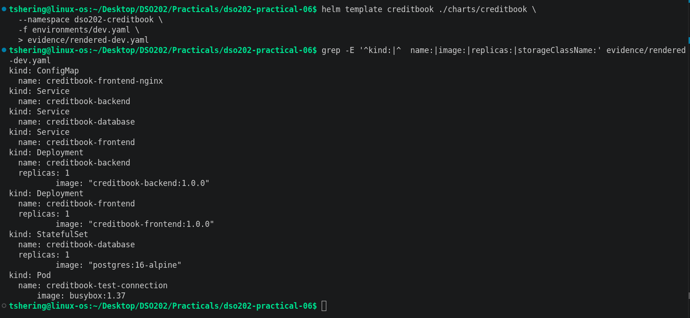
**Screenshot 7:** Rendered manifests.  

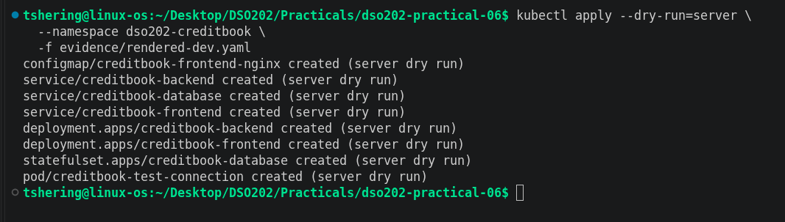
**Screenshot 8:** Server-side dry-run result.

## 11. Deployment

The release was installed with:

```bash
helm upgrade --install creditbook ./charts/creditbook \
  --namespace dso202-creditbook \
  -f environments/dev.yaml \
  --atomic \
  --timeout 5m
```

The command uses `upgrade --install`, which installs the release if it does not exist and upgrades it otherwise. The `--wait` option waits for resources to become ready. `--atomic` requests automatic rollback behaviour if the operation fails.

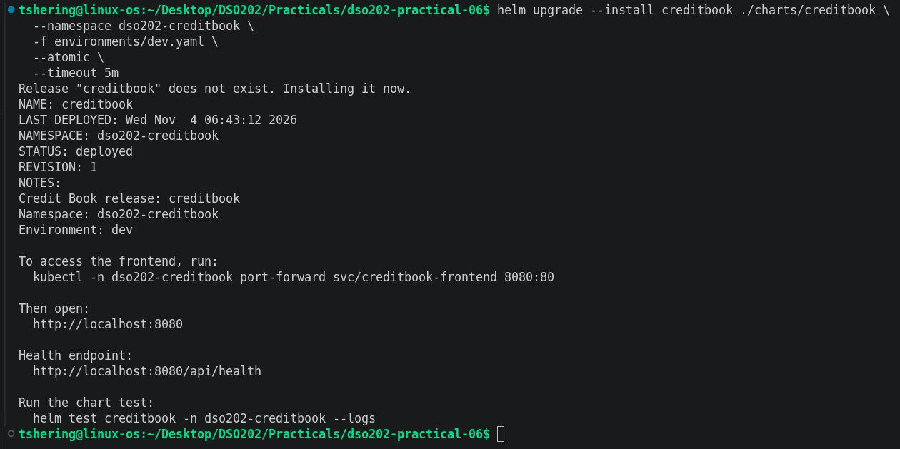
**Screenshot 9:** Helm installation output and release status.

## 12. Verification

The following commands were used to inspect the release and Kubernetes resources:

```bash
helm list -n dso202-creditbook
helm status creditbook -n dso202-creditbook
helm get values creditbook -n dso202-creditbook
kubectl get all,pvc,configmap,secret -n dso202-creditbook
kubectl get pods -n dso202-creditbook -o wide
```

The frontend was accessed through port forwarding:

```bash
kubectl port-forward -n dso202-creditbook \
  svc/creditbook-frontend 8080:80
```

The following endpoints were checked:

```bash
curl -i http://localhost:8080/
curl -i http://localhost:8080/api/health
curl -i http://localhost:8080/api/transactions
```

A transaction was added through the web interface and checked in the transaction history.

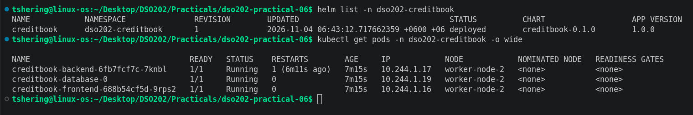
**Screenshot 10:** Running Pods and Services.  

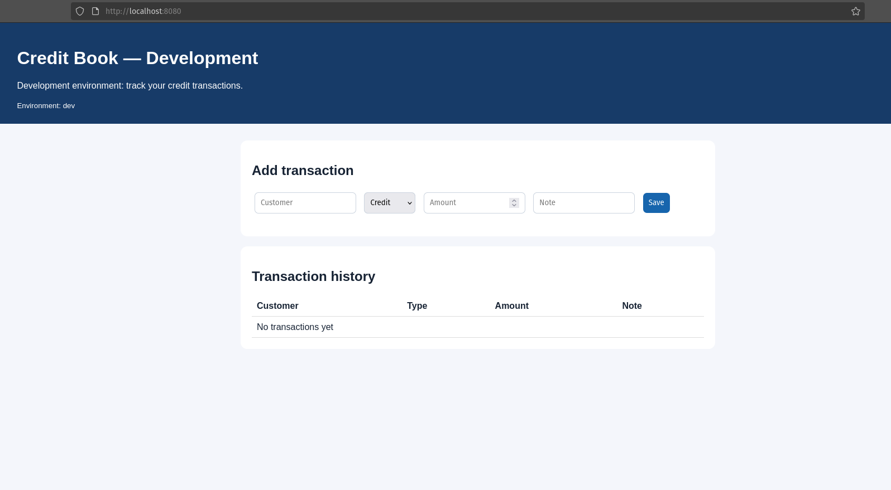
**Screenshot 11:** Credit Book frontend in the browser.

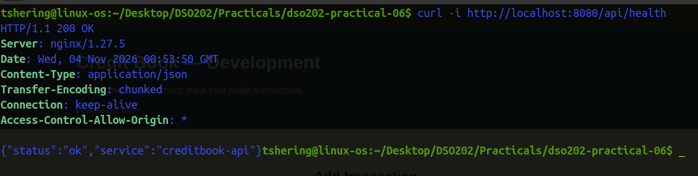
**Screenshot 12:** Health endpoint response.  

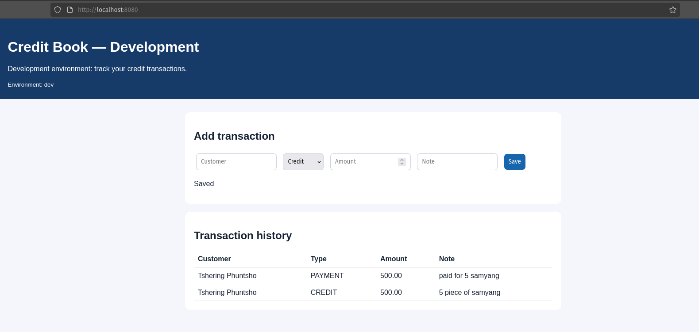
**Screenshot 13:** Transaction successfully created and listed.

## 13. Helm Test

A test Pod is defined using the Helm test hook annotation. It requests the frontend and backend health endpoint and checks the expected response.

Command:

```bash
helm test creditbook -n dso202-creditbook
```
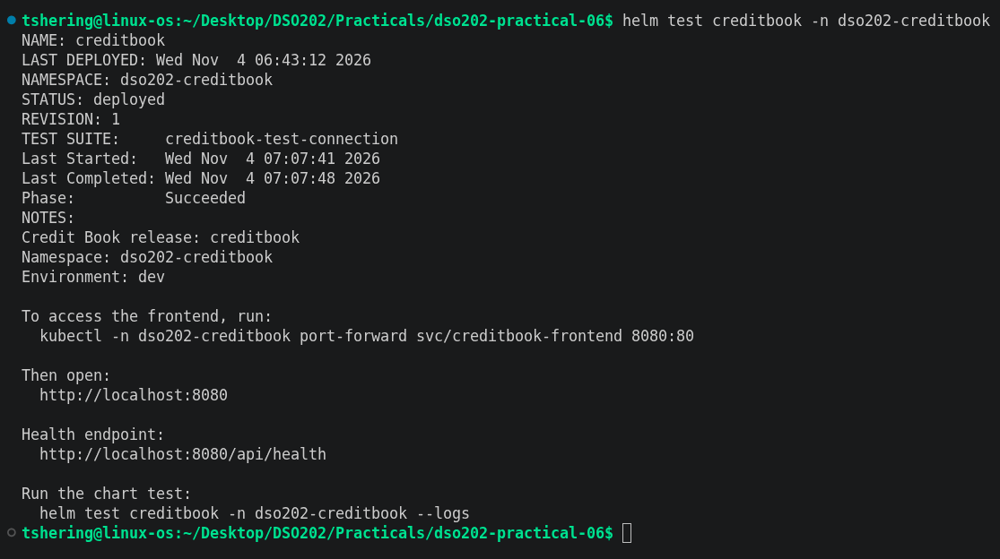
**Screenshot 14:** Helm test result.

## 14. Upgrade and Rollback

The release history was inspected before upgrading:

```bash
helm history creditbook -n dso202-creditbook
```

After changing the frontend pageMessage in `environments/dev.yaml`, the release was upgraded using the complete values file:

```bash
helm upgrade creditbook ./charts/creditbook \
  --namespace dso202-creditbook \
  -f environments/dev.yaml \
  --wait --timeout 5m \
  --rollback-on-failure
```

The release history was checked again. The previous revision was restored with:

```bash
helm rollback creditbook 1 -n dso202-creditbook --wait --timeout 5m
helm history creditbook -n dso202-creditbook
```

A rollback creates a new revision containing the earlier chart and values. It does not erase the revisions created after the original one.

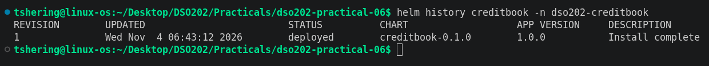
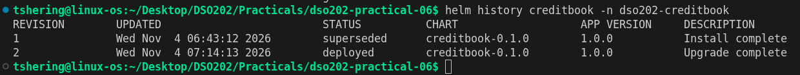
**Screenshot 15:** Release history before and after upgrade.  

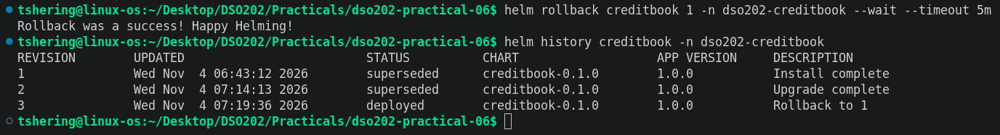
**Screenshot 16:** Successful rollback and updated history.

## 15. Chart Packaging

The chart was packaged as a versioned archive:

```bash
mkdir -p dist
helm package ./charts/creditbook --destination dist
helm show chart ./dist/creditbook-0.1.0.tgz
```

The `.tgz` archive can be distributed and installed as a chart package. The chart version should be incremented whenever chart content changes.

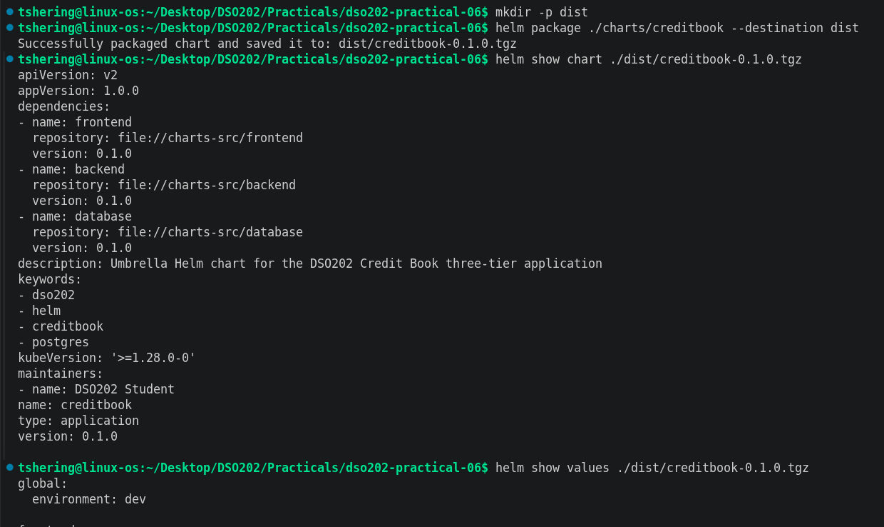
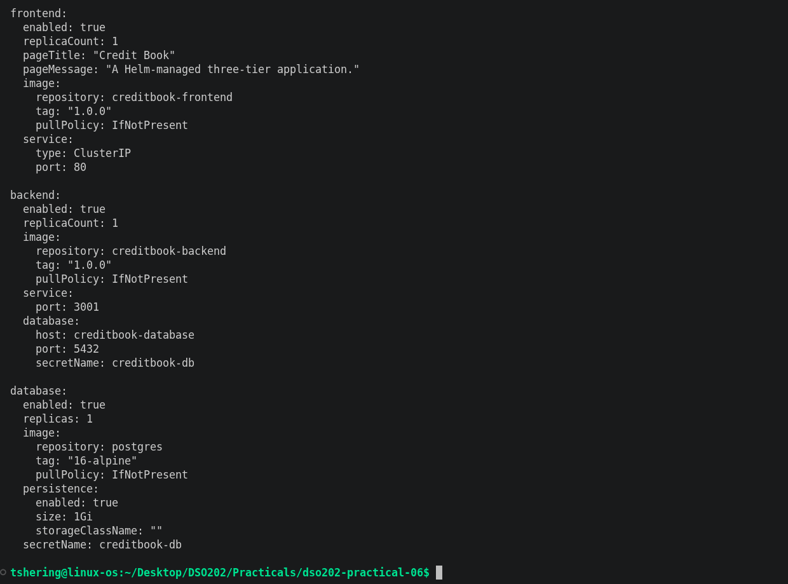
**Screenshot 17:** Packaged chart archive and chart metadata.

## 16. Cleanup

After evidence was collected, the Helm release was removed:

```bash
helm uninstall creditbook -n dso202-creditbook
kubectl get all -n dso202-creditbook
kubectl delete pvc --all -n dso202-creditbook
kubectl delete namespace dso202-creditbook
kubectl get pvc -n dso202-creditbook
```

PVCs may remain after uninstall, so they were inspected separately and deleted only when confirmed to be lab resources.

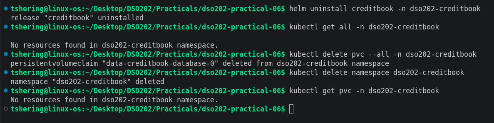
**Screenshot 18:** Helm uninstall and cleanup verification.

## 17. Learning Outcomes

Through this practical, I learned how Helm packages Kubernetes resources into charts and manages installations as releases. I gained practical experience creating an umbrella chart with subcharts, using values files for environment-specific configuration, and writing reusable Go templates. I also learned to validate charts before deployment, reference Kubernetes Secrets securely, inspect Helm release history, run chart tests, package charts, and demonstrate upgrades and rollbacks.

## 18. Conclusion

This practical successfully demonstrates the design and deployment of a multi-component application using Helm on Kubernetes. The umbrella chart provides a reusable and configurable deployment for the frontend, backend and database components. Helm's templating, values management, validation and release lifecycle features make it easier to maintain and operate the application as one unit.
